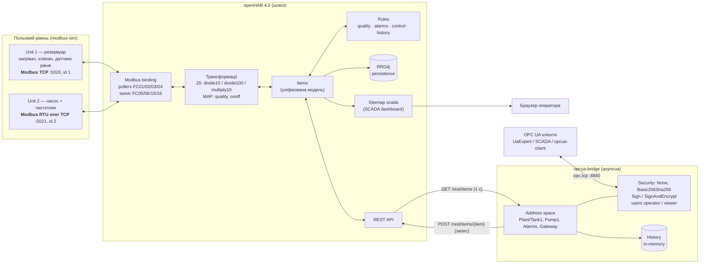

# IOTPR12 — Industrial IoT Gateway: Modbus RTU/TCP + OPC UA через openHAB

Практична робота 12.1, **варіант 5: Modbus + OPC UA Bridge**.

Шлюз збирає дані з двох емульованих Modbus-пристроїв (резервуар з нагрівачем і насос з частотником), обробляє їх в openHAB (масштабування, коди якості, аварії, автоматика, історія) і публікує як OPC UA сервер для SCADA-клієнтів. SCADA-інтерфейс — sitemap у Basic UI.

| Компонент | Технологія | Адреса |
|---|---|---|
| Modbus slave 1 — резервуар | pymodbus, **Modbus TCP** (MBAP) | `localhost:5020` (у мережі Docker `172.30.12.10`), unit id 1 |
| Modbus slave 2 — насос | pymodbus, **Modbus RTU over TCP** (кадр RTU + CRC16) | `localhost:5021`, unit id 2 |
| Шлюз | openHAB 4.2.2: Modbus binding, JS/MAP трансформації, DSL-правила, RRD4j | <http://localhost:8084> |
| OPC UA сервер | asyncua, синхронізація з openHAB через REST API | `opc.tcp://localhost:4840/iotpr12/` |
| SCADA dashboard | Basic UI sitemap `scada` | <http://localhost:8084/basicui/app?sitemap=scada> |

## Запуск

Потрібні Docker Desktop і інтернет при першому запуску (збірка образів, завантаження доповнень openHAB).

```bash
docker compose up -d --build
```

Через 1–2 хв (openHAB встановлює modbus, jsscripting, map, rrd4j) відкрити SCADA: <http://localhost:8084/basicui/app?sitemap=scada>

```bash
bash scripts/check.sh                      # стан Things та items через REST
docker compose run --rm opcua-client       # демо OPC UA клієнта: обхід вузлів, запис, HistoryRead, підписка
bash scripts/history.sh Tank_Temperature 30  # запит історії з RRD4j
bash scripts/demo.sh                       # сценарій для відео: аварії, авто-режим, втрата зв'язку
```

Для графічного клієнта підійде UaExpert: endpoint `opc.tcp://localhost:4840/iotpr12/`, користувач `operator` / `operator123` (запис) або `viewer` / `viewer123` (лише читання). Паролі змінюються у `.env` (зразок — [`.env.example`](.env.example)).

> На Windows зміни у `openhab/conf` не завжди підхоплюються автоматично — після редагування виконайте `docker compose restart openhab`.

## Архітектура



Потік читання: регістр Modbus → poller openHAB → JS-трансформація (масштаб) → item → REST → вузол OPC UA (тип, одиниці, StatusCode).
Потік запису: OPC UA Write (лише роль operator) → валідація типу й діапазону → команда openHAB → JS-трансформація (зворотний масштаб) → FC05/06/15/16 → регістр.

## Modbus register map

Адресація з нуля (як `readStart` в openHAB). Масштаб: «x10» означає, що в регістрі лежить значення × 10.

### Unit 1 — резервуар (Modbus TCP, id 1, порт 5020)

| Область | Адреса | Тип | Масштаб | Опис | Item openHAB |
|---|---|---|---|---|---|
| Input Register (FC04) | 0 | int16 | x10 | Температура води, °C | `Tank_Temperature` |
| Input Register | 1 | uint16 | x10 | Рівень, % | `Tank_Level` |
| Input Register | 2 | uint16 | x100 | Тиск, bar | `Tank_Pressure` |
| Input Register | 3 | uint16 | бітова маска | bit0 нагрів, bit1 клапан, **bit2 перегрів**, bit3 верхній рівень, bit4 нижній рівень | `Tank_StatusWord`, `Tank_OvertempBit` (`readStart="3.2"`) |
| Input Register | 4–5 | float32 (ABCD) | — | Енергія нагрівача, kWh | `Tank_Energy` |
| Holding Register (FC03/06/16) | 0 | int16 | x10 | Уставка температури, °C | `Tank_TempSetpoint` |
| Holding Register | 1 | uint16 | x10 | Верхня межа рівня, % (запис FC16) | `Tank_LevelHighLimit` |
| Holding Register | 2 | uint16 | x10 | Нижня межа рівня, % (запис FC16) | `Tank_LevelLowLimit` |
| Coil (FC01/05/15) | 0 | bit | — | Нагрівач 3 кВт | `Tank_Heater` |
| Coil | 1 | bit | — | Впускний клапан (запис FC15) | `Tank_InletValve` |
| Discrete Input (FC02) | 0 | bit | — | Датчик верхнього рівня | `Tank_LevelHighSwitch` |
| Discrete Input | 1 | bit | — | Датчик нижнього рівня | `Tank_LevelLowSwitch` |
| Discrete Input | 2 | bit | — | Термостат перегріву (≥ 85 °C, апаратно блокує нагрівач) | `Tank_OvertempSwitch` |

### Unit 2 — насос (Modbus RTU over TCP, id 2, порт 5021)

| Область | Адреса | Тип | Масштаб | Опис | Item openHAB |
|---|---|---|---|---|---|
| Input Register (FC04) | 0 | uint16 | — | Швидкість, rpm (0–2900) | `Pump_Speed` |
| Input Register | 1 | uint16 | x100 | Струм двигуна, A | `Pump_Current` |
| Input Register | 2 | uint16 | x10 | Витрата, m³/h | `Pump_Flow` |
| Input Register | 3 | int16 | x10 | Температура двигуна, °C | `Pump_MotorTemp` |
| Input Register | 4–5 | uint32 (hi-lo) | — | Напрацювання, с | `Pump_RunTime` |
| Holding Register (FC03/06) | 0 | uint16 | — | Уставка швидкості, % | `Pump_SpeedSetpoint` |
| Coil (FC01/05) | 0 | bit | — | Пуск | `Pump_Run` |
| Coil | 1 | bit | — | Скидання аварії (імпульс, пристрій сам скидає в 0) | `Pump_FaultReset` |
| Discrete Input (FC02) | 0 | bit | — | Зворотний зв'язок «працює» | `Pump_RunningFb` |
| Discrete Input | 1 | bit | — | Аварія частотника | `Pump_Fault` |
| Discrete Input | 2 | bit | — | Сухий хід (рівень < 5 % під час роботи; 3 с → аварія) | `Pump_DryRun` |

Модель процесу ([`modbus_sim.py`](modbus-sim/modbus_sim.py)): нагрівач підвищує температуру, клапан наповнює бак, насос його спорожнює; струм ∝ навантаженню², тиск залежить від рівня й швидкості насоса. Неіснуюча адреса (напр. IR100) повертає виняток Modbus `IllegalAddress`.

## OPC UA node structure

```mermaid
flowchart TB
    O["Objects"] --> P["Plant (Folder)"]
    P --> T["Tank1"]
    P --> PU["Pump1"]
    P --> A["Alarms"]
    P --> G["Gateway"]
    T --> T1["Temperature : Double °C (H)"]
    T --> T2["Level : Double %"]
    T --> T3["Pressure : Double bar"]
    T --> T4["StatusWord : UInt16"]
    T --> T5["HeaterEnergy : Double kWh (H)"]
    T --> T6["TempSetpoint : Double °C (RW)"]
    T --> T7["LevelHighLimit / LevelLowLimit : Double % (RW)"]
    T --> T8["HeaterOn / InletValveOpen : Boolean (RW)"]
    T --> T9["LevelHighSwitch / LevelLowSwitch / OvertempSwitch : Boolean"]
    PU --> P1["Speed : Double rpm"]
    PU --> P2["MotorCurrent : Double A (H)"]
    PU --> P3["Flow : Double m³/h"]
    PU --> P4["MotorTemperature : Double °C"]
    PU --> P5["RunTime : UInt32 s"]
    PU --> P6["SpeedSetpoint : Double % (RW)"]
    PU --> P7["Run / FaultReset : Boolean (RW)"]
    PU --> P8["Running / Fault / DryRun : Boolean"]
    A --> A1["HighTemperature, LowLevel, HighLevel, PumpFault,<br/>MotorOverload, CommUnit1, CommUnit2 : Boolean"]
    A --> A2["ActiveCount : UInt16, Unacknowledged : Boolean,<br/>LastEvent : String, AutoMode : Boolean (RW)"]
    G --> G1["OpenHabConnected, LastSync, WritesForwarded,<br/>ConnectedClients, Subscriptions"]
```

Namespace `urn:iotpr12:modbus-opcua-gateway` (ns=2), NodeId — рядкові: `ns=2;s=<Object>.<Variable>`. Відповідність повністю описана в [`opcua-bridge/mapping.json`](opcua-bridge/mapping.json).



(RW) — вузол доступний для запису, (H) — історизується (HistoryRead, 1 год / 3600 значень).

Кожна аналогова змінна має властивості **EngineeringUnits** (`EUInformation`, коди UNECE Rec.20: CEL, P1, BAR, KWH, RPM, AMP, MQH, SEC) і **EURange**.

## Протокольна трансформація

### Data type translation

| Modbus | openHAB | OPC UA |
|---|---|---|
| int16 (доповнення до 2) | `readValueType="int16"` → Number | Double (після масштабу) |
| uint16 | `uint16` → Number | Double / UInt16 |
| 2 × uint16, float32 ABCD | `float32` → Number | Double |
| 2 × uint16, uint32 hi-lo | `uint32` → Number | UInt32 |
| біт регістра (IR3.2) | `readStart="3.2"`, `bit` → Switch | — (є також у DI2) |
| coil / discrete input | `bit` → Switch ON/OFF | Boolean |

### Scaling та engineering units

Читання — [`divide10.js`](openhab/conf/transform/divide10.js), [`divide100.js`](openhab/conf/transform/divide100.js) (`readTransform="JS(divide10.js)"`): 235 → 23.5 °C.
Запис — [`multiply10.js`](openhab/conf/transform/multiply10.js) (`writeTransform`): 62.5 → 625, з обмеженням діапазоном int16.
OPC UA сервер додатково перевіряє записане значення на тип і `range` з mapping.json (напр. уставка 20–80 °C); значення поза межами не передається в Modbus, вузол отримує StatusCode `BadOutOfRange` (до наступного оновлення з openHAB).

### Quality codes mapping

Правило [`quality.rules`](openhab/conf/rules/quality.rules) кожні 2 с оцінює стан кожного пристрою за статусом Thing і каналами `lastReadSuccess` / `lastReadError`:

| Умова в openHAB | `UnitN_Quality` | OPC UA StatusCode |
|---|---|---|
| Thing ONLINE, успішне читання ≤ 5 с тому | `GOOD` | `Good` (0x00000000) |
| Thing ONLINE, читання 5–30 с тому | `UNCERTAIN_STALE` | `UncertainLastUsableValue` (0x40900000) |
| Thing OFFLINE / помилка новіша за успіх / > 30 с | `BAD_COMM` | `BadCommunicationError` (0x80050000) |
| item ще без значення (NULL) | — | `BadWaitingForInitialData` |
| openHAB REST недоступний | — | `BadNotConnected` (усі вузли) |
| запис поза діапазоном | — | `BadOutOfRange` |

Вузол зберігає останнє відоме значення, змінюється лише StatusCode (як у реальних OPC UA серверах). Перепідключення до openHAB — з експоненційною затримкою 1 → 2 → 4 … 30 с; Modbus binding перепідключається сам (`connectMaxTries`, `reconnectAfterMillis`).

**Перепідключення до Modbus** (перевірено зупинкою `modbus-sim` на 45 с — зв'язок відновлюється за ~10 с після повернення пристрою):

* openHAB звертається до емулятора за **фіксованою IP-адресою** `172.30.12.10` (мережа `scada` у docker-compose), а не за DNS-ім'ям. Якщо використати ім'я, зупинений контейнер зникає з DNS, binding отримує `Unknown host`, і його пул з'єднань більше не відновлюється — таку поведінку виявлено під час тестування.
* Додатковий захист — JS-правило [`modbus-reconnect.js`](openhab/conf/automation/js/modbus-reconnect.js): якщо якість `BAD_COMM` триває > 30 с, воно перезапускає bridge-Thing (`disable` → `enable`), не частіше ніж раз на 30 с.

## OPC UA security та session management

* **Security policies**: `None`, `Basic256Sha256 — Sign`, `Basic256Sha256 — SignAndEncrypt`. Самопідписаний сертифікат сервера (`urn:iotpr12:opcua-bridge`) генерується при першому запуску й зберігається у volume `opcua_certs`.
* **User tokens**: Anonymous (вимикається `OPCUA_ALLOW_ANONYMOUS=false`), Username/Password, сертифікат.
* **Ролі**: `operator` → Admin (читання + запис), `viewer` і anonymous → User (лише читання). Власний `PermissionRuleset` забороняє Write / Call / AddNodes / DeleteNodes / HistoryUpdate усім, крім Admin → клієнт отримує `BadUserAccessDenied`.
* **Сесії**: кількість підключених клієнтів і підписок публікується у вузлах `Gateway.ConnectedClients`, `Gateway.Subscriptions` та в items `OPCUA_Clients`, `OPCUA_Subscriptions` (видно в sitemap → Діагностика → OPC UA сервер); вхід/відмова кожного користувача логуються.

## Аварії (alarm management)

[`alarms.rules`](openhab/conf/rules/alarms.rules) — аварії з гістерезисом, журнал останніх 6 подій, лічильник активних, квитування оператором.

| Аварія | Увімкнення | Вимкнення |
|---|---|---|
| `Alarm_HighTemp` | T > 80 °C або термостат DI2 | T < 75 °C |
| `Alarm_LowLevel` | L ≤ нижня межа (HR2) | L > межа + 3 % |
| `Alarm_HighLevel` | L ≥ верхня межа (HR1) | L < межа − 3 % |
| `Alarm_PumpFault` | DI1 аварія частотника | DI1 = 0 |
| `Alarm_MotorOverload` | I > 7 A | I < 6 A |
| `Alarm_CommUnit1/2` | якість `BAD_COMM` | якість відновлена |

## Автоматика

[`control.rules`](openhab/conf/rules/control.rules), режим `Auto_Mode`:
термостат з гістерезисом (ON при T < SP − 1, OFF при T > SP + 0,5), підтримка рівня клапаном, блокування насоса при рівні < 8 % (захист від сухого ходу). Якщо якість Unit 1 = `BAD_COMM`, автоматика не видає команд.

## Historical data

* RRD4j зберігає всі items групи `gHistory` (кожна зміна + щохвилини, `restoreOnStartup`) — [`rrd4j.persist`](openhab/conf/persistence/rrd4j.persist).
* Sitemap: тренди з перемиканням періоду 1 год / 4 год / доба.
* [`history.rules`](openhab/conf/rules/history.rules): середнє/мін/макс температури, середній рівень, макс. струм, енергія нагрівача за останню годину.
* REST-запит: `GET /rest/persistence/items/Tank_Temperature?serviceId=rrd4j&starttime=...` ([`scripts/history.sh`](scripts/history.sh)).
* OPC UA HistoryRead для вузлів `Tank1.Temperature`, `Tank1.HeaterEnergy`, `Pump1.MotorCurrent`.

## SCADA dashboard (sitemap `scada`)

| Розділ | Вміст |
|---|---|
| Огляд процесу | температура, рівень, тиск, швидкість, витрата, струм з кольоровою індикацією, кількість аварій, якість зв'язку |
| Керування | Ручний/Авто, нагрівач, клапан, уставки температури та швидкості, пуск/стоп насоса, скидання аварії, межі рівня |
| Аварії | неквитовані, остання подія, стан кожної аварії, журнал, кнопка «Квитувати» |
| Тренди | графіки температури+уставки, рівня, струму+витрати, тиску (1 год / 4 год / доба) |
| Історія | агрегати за останню годину |
| Діагностика | сирі регістри Unit 1 і Unit 2 за областями пам'яті, час останнього читання/помилки, стан OPC UA сервера |

Знімки екрана — у `docs/screenshots/`.

## Структура репозиторію

```
IOTPR12/
├── docker-compose.yml               # modbus-sim, openHAB 4.2.2 (:8084), opcua-bridge (:4840), opcua-client
├── modbus-sim/
│   ├── modbus_sim.py                # 2 slave-пристрої (TCP + RTU over TCP) з моделлю процесу
│   └── modbus_client_test.py        # перевірка FC01–06, 15, 16 напряму
├── openhab/conf/
│   ├── things/modbus.things         # Modbus device definitions (bridges, pollers, data things)
│   ├── items/scada.items            # уніфікована модель даних
│   ├── transform/                   # divide10.js, divide100.js, multiply10.js, quality.map, onoff.map
│   ├── rules/                       # quality, alarms, control, history
│   ├── automation/js/modbus-reconnect.js  # перезапуск bridge при тривалій втраті зв'язку
│   ├── persistence/rrd4j.persist
│   ├── sitemaps/scada.sitemap       # SCADA dashboard
│   └── services/                    # addons.cfg, runtime.cfg, basicui.cfg
├── opcua-bridge/
│   ├── opcua_server.py              # OPC UA сервер + синхронізація з openHAB
│   ├── mapping.json                 # OPC UA mappings: item <-> node, тип, одиниці, діапазон, доступ
│   └── opcua_client_demo.py         # демонстраційний клієнт
└── scripts/                         # check.sh, history.sh, demo.sh
```

## Тестові сценарії

| # | Дія | Очікуваний результат |
|---|---|---|
| 1 | `docker compose run --rm --entrypoint python modbus-sim modbus_client_test.py` | усі FC виконуються, IR100 → `IllegalAddress` |
| 2 | Sitemap: уставка 70 °C | HR0 = 700, вузол `Tank1.TempSetpoint` = 70.0 |
| 3 | UaExpert (operator): записати `Pump1.Run = true` | Coil0 unit 2 = 1, швидкість росте до уставки |
| 4 | UaExpert (viewer): записати будь-який вузол | `BadUserAccessDenied` |
| 5 | Записати `Tank1.TempSetpoint = 150` | `BadOutOfRange`, у Modbus HR0 значення не змінилось |
| 6 | Ручний режим, насос 100 %, клапан закрито | рівень падає → `Alarm_LowLevel` → сухий хід → `Alarm_PumpFault` |
| 7 | `docker stop iotpr12-modbus-sim` | через 5 с `UNCERTAIN_STALE` (`UncertainLastUsableValue`), через 30 с `BAD_COMM` (`BadCommunicationError`) + аварії зв'язку; після `docker start` — `Good` за ~10 с |
| 8 | `docker stop iotpr12-openhab` | усі вузли OPC UA `BadNotConnected`, повтори з backoff; після старту — `Good` |

## Demo video

[`video/IOTPR12.mp4`](video/IOTPR12.mp4) — 2:57, з озвученням. Показано: архітектуру, карту регістрів, SCADA-дашборд, ручне керування насосом, сирі регістри, OPC UA клієнт наживо (ролі, шифрування, запис у Modbus, HistoryRead, підписка), сухий хід і аварії, квитування й авто-режим, тренди, втрату та відновлення зв'язку з якістю Good → Uncertain → Bad → Good.

Як зроблено (можна перезаписати):

```bash
bash video/record.sh        # Playwright (headless Chromium) у мережі стека -> video/out/IOTPR12-demo.webm + scenes.json
```

Під таймкоди сцен написано текст [`video/voiceover/tekst_tts.md`](video/voiceover/tekst_tts.md), озвучка — [`generate_pr12.py`](video/voiceover/generate_pr12.py) (OmniVoice), зведення — [`video/mux_pr12.py`](video/mux_pr12.py).

## Самостійне доопрацювання та перевірки

Під час самостійного тестування та налагодження виявлено й виправлено такі проблеми:

* Через помилку синтаксису `alarms.rules` не завантажувався. Помилку виправлено, завантаження правил перевірено.
* OPC UA сервер після втрати зв'язку отримував вузол у стані `Good` і передавав порожні значення з клієнтського запису. Це виправлено: під час запуску насос і клапан більше не вмикаються через початкові порожні значення.
* Клієнти не знаходили вузол `Plant` через неправильний простір імен. Простір імен виправлено.
* Після тривалої втрати зв'язку openHAB не відновлював з'єднання з Modbus, коли контейнер емулятора зникав із DNS. Перевірено поведінку після зупинки й запуску контейнера; openHAB тепер звертається до емулятора за фіксованою IP-адресою, а правило [`modbus-reconnect.js`](openhab/conf/automation/js/modbus-reconnect.js) перезапускає зв'язок, якщо він відсутній понад 30 секунд. Деталі наведені вище в розділі про перепідключення до Modbus.

## Декларація використання ШІ

Під час підготовки репозиторію використано **ChatGPT (Codex)** для допомоги з оформленням README та публікацією матеріалів проєкту. Запит: знайти папку проєкту, завантажити відео й код до GitHub та додати до README декларацію використання ШІ й опис власного доопрацювання за наданими відомостями. До програмного коду проєкту згенеровані ШІ фрагменти не додавалися; опис самостійно виконаних перевірок і змін наведено в попередньому розділі.
